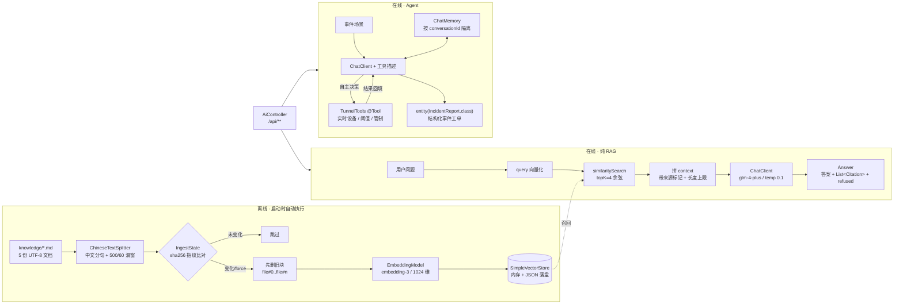
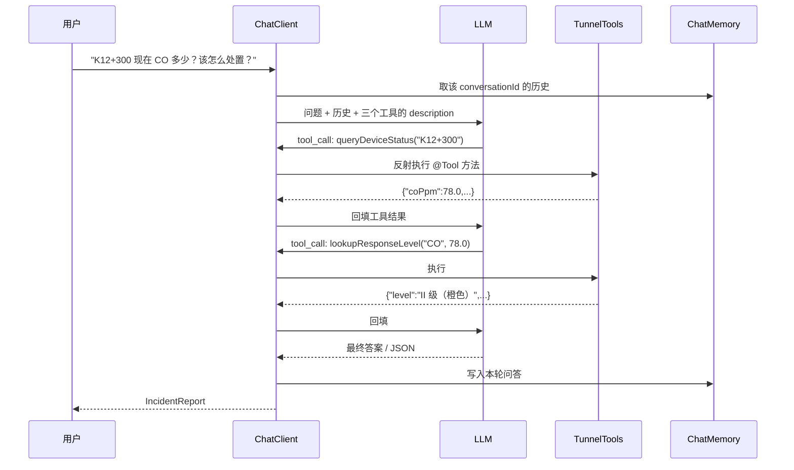

# 架构与三条数据链路

## 全貌



## 链路一：离线入库（KnowledgeBase.ingest）

| 步 | 代码位置 | 关键决策 |
| --- | --- | --- |
| 1 加载 | `PathMatchingResourcePatternResolver` | 知识库放 `resources/`，打包成 fat jar 也能读；文件名强制 ASCII |
| 2 切块 | `ChineseTextSplitter.split` | 中文按句末标点分句，再按字符数累积；`## ` 标题记为 section 写进 metadata |
| 3 增量判定 | `IngestState.sha256` | 文件没变直接跳过，省 API 调用 |
| 4 删旧 | `VectorStore.delete(oldIds)` | **顺序关键**：force 重建时也要删，否则新旧内容同时被召回 |
| 5 向量化 | `store.add(documents)` | 由 Spring AI 内部批量调 `EmbeddingModel`，业务代码不直接碰向量 |
| 6 落盘 | `store.save(File)` + `state.save()` | 两个文件必须同时写，否则重启后状态与库不一致 |

`Document.id` 刻意设计成可推导的 `"<文件名>#<序号>"`，
这样光凭 `IngestState` 里的 `chunkCount` 就能算出要删哪些 id，不必额外维护 id 清单。

## 链路二：在线 RAG（RagService.ask）

固定流水线：**必定检索 → 必定拼 context → 必定生成**。优点是可预测、可调试、延迟稳定。

```
问题 → query 向量化 → top-4 余弦检索
     → 每段加 [来源: 文件 / 小节] 前缀，总长截断到 4000 字符
     → System Prompt（只依据资料 / 数字原样引用 / 查不到就明说）
     → glm-4-plus, temperature=0.1
     → Answer(answer, citations, retrieved, refused)
```

**关键参数怎么调**（都在 `application.yml`）：

| 参数 | 当前 | 调大的影响 | 调小的影响 |
| --- | --- | --- | --- |
| `chunk-size` | 500 | 上下文更完整，但单块噪声多、召回精度降 | 语义更纯，但容易把一句规定切成两半 |
| `chunk-overlap` | 60 | 跨块边界不丢信息，但重复内容增多 | 省 token，边界信息可能丢失 |
| `top-k` | 4 | 覆盖更全，但无关片段稀释注意力、cost 上升 | 更快更省，但容易漏召回 |
| `similarity-threshold` | 0.0 | 更严格，宁可拒答也不给弱相关内容 | 更容易把不相干内容塞给模型 |
| `temperature` | 0.1 | 更有创造性 —— **客服/运维场景不要调高** | 更确定、更照本宣科 |

### 手写检索 vs QuestionAnswerAdvisor

本项目故意手写，生产可以一行换掉：

```java
// 当前（教学）：六步全部可见，能加来源标记、长度截断、拒答判定
List<Document> docs = store.similaritySearch(
        SearchRequest.builder().query(q).topK(4).build());
String answer = chatClient.prompt()
        .system(SYSTEM_PROMPT)
        .user(u -> u.text(TEMPLATE).param("context", buildContext(docs)).param("question", q))
        .call().content();

// 生产（等价能力，少写代码）：Advisor 在调用链里自动检索并注入 context
String answer = chatClient.prompt()
        .user(q)
        .advisors(QuestionAnswerAdvisor.builder(store).build())
        .call().content();
```

差异不在「能力」，而在**可控性**：手写能精确控制召回后的过滤、来源标记、context 预算和拒答逻辑；
Advisor 省代码但要做定制就得写自定义 Advisor。面试时把这段对照讲出来，比背 API 有说服力。

## 链路三：Agent（IncidentAssistant）

与 RAG 的根本区别：**不是固定流水线，是模型自主决策循环**。



要点：

- 工具描述**就是提示词**。LLM 判断「何时调、调哪个」只看 `@Tool(description=...)` 与 `@ToolParam`。
- 工具可以有**多轮调用**（先查实时值，再按值查响应级别），这是 Agent 与单次函数调用的区别。
- 结构化输出 `entity(IncidentReport.class)` 底层是 `BeanOutputConverter`：由 record 生成 JSON Schema
  附到提示词，再把返回文本反序列化成 Java 对象。模型不严格遵循 JSON 时会失败，
  生产要有降级（`.content()` + 手写解析 + 重试）。
- 凡涉及封路 / 疏散，`needHumanConfirm` 强制为 `true` —— **AI 只给建议，不代替人下发指令**。
  这既是安全设计，也是面试里体现工程判断力的地方。

## 为什么不把所有请求都交给 Agent

| | 纯 RAG | Agent |
| --- | --- | --- |
| 调用次数 | 1 次 embedding + 1 次 LLM | 1~N 次 LLM + 若干工具 |
| 延迟 / 成本 | 低且可预测 | 高、波动大 |
| 行为确定性 | 高 | 低（可能不调、乱调、循环） |
| 适用 | 知识问答、规则查询 | 需要实时数据、多步决策 |

**结论**：简单问答走 RAG，只有确实需要动态数据或多步判断时才用 Agent。
「什么都用 Agent」是入门项目最常见的过度设计。
