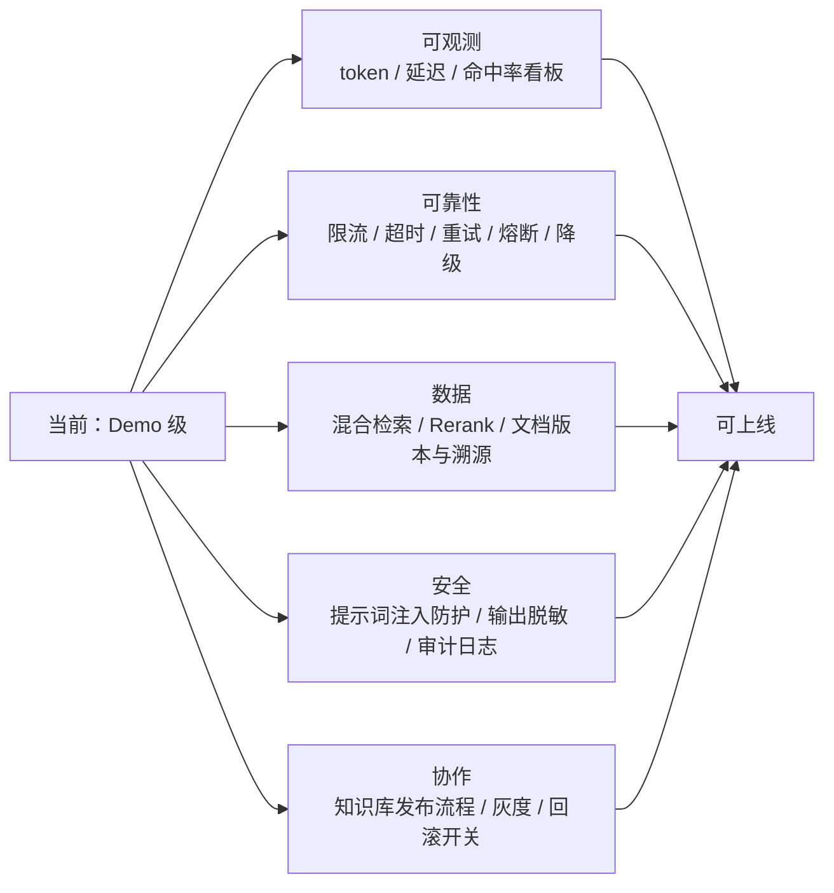

# 已知问题与演进方向

> 面试时主动讲局限，比被问出来强。这里每一条都是**真实的取舍**，不是凑数的 TODO。

## 一、当前实现明确的局限

| # | 局限 | 影响 | 为什么现在不修 |
| --- | --- | --- | --- |
| 1 | `SimpleVectorStore` 是内存 O(n) 全量扫描 | 数据量大后检索线性变慢；重启要从 JSON 恢复 | 入门项目要零外部依赖，clone 即跑 |
| 2 | 中文切块按标点 + 字符数，不理解语义 | 表格、长条款可能被切开 | 语义切分需要额外模型/库，会掩盖 RAG 主链路 |
| 3 | 只有向量检索，没有 BM25 / 混合检索 | 对精确术语（桩号、型号、错误码）不敏感 | 需要引入检索库，超出入门范围 |
| 4 | 没有 Rerank | Top-4 里可能混入弱相关片段 | 加 rerank 模型会增加一次推理成本 |
| 5 | 评估用关键词命中，不是语义判断 | 「3 个月」写成「约 90 天」会被误判为失败 | LLM-as-Judge 更准但要花 API 费用，且自身也要校准 |
| 6 | `ChatMemory` 是进程内实现 | 重启丢失、多实例不共享 | 与 Session 放内存是同一权衡，外置需 Redis/JDBC |
| 7 | `TunnelTools` 返回模拟数据 | 不能反映真实现场 | 刻意保留，让读者聚焦 Tool 抽象而非对接业务系统 |
| 8 | 工具描述与业务规则在代码里各写了一份 | 改阈值可能只改了一处，产生不一致 | 生产应从同一份规则源生成工具描述与知识库 |
| 9 | `IngestState` 用纯文件名做 key | 子目录同名文件会互相覆盖 | 当前知识库扁平，无子目录 |
| 10 | state 与 vector-store 两个文件分别落盘 | 极端情况下（写一半进程被杀）状态不一致 | 真事务需要外部向量库支持 |
| 11 | 结构化输出依赖模型遵从 JSON Schema | 模型可能返回带 Markdown 代码块的文本导致解析失败 | 已写降级方案，未实现自动重试 |
| 12 | 没有限流、审计、提示词脱敏 | 不能承受公开流量，有数据外泄风险 | 属于平台上层能力，不是 AI 链路本身 |
| 13 | `langchain-community` 式的供应商绑定风险 | 智谱端点路径/属性名与版本强相关 | 已通过配置隔离，见下方 K01/K02 |

## 一·补 · 一个已经修掉的真实时序问题

首次端到端冒烟时发现：`/actuator/health` 返回 `UP`，但 `AutoIngestRunner` 还在调 Embedding API，
此时向量库只有 1 块，问「CO 78ppm 怎么处置」会得到**自信但错误**的「I 级全封闭」
（正确是 II 级「关闭入口、限制通行」）。健康探针没撒谎，只是它只检查 Web 容器。

**修复**（已实现）：

- `KnowledgeBase.isReady()` 暴露入库状态；
- `KnowledgeBaseHealthIndicator` 把它纳入 Actuator —— 入库完成前整体是 `OUT_OF_SERVICE`（HTTP 503），
  K8s readinessProbe / 网关探活会自动挡流量；
- `RagService.ask()` 二次兜底，未就绪直接抛 `IllegalStateException` → 503，
  即使请求绕过探针也不会用残缺资料编答案。

> 这个坑值得记住：**AI 应用多了一个「依赖尚未就绪」的状态，而传统 Web 应用通常没有。**
> 把新依赖纳入既有运维体系（健康检查、超时、降级），是后端经验能直接迁移的地方。

## 二、优先级最高的三个改进（推荐练手顺序）

**P0 · 混合检索（BM25 + 向量）**
隧道场景里「K12+300」「80 ℃」「12122」这类精确字符串用纯向量检索并不稳。
做法：召回阶段同时跑关键词检索与向量检索，用 RRF 融合排序，再截断到 Top-K。
验收：评估集里 E05–E08、E11、E13 这些「精确数值题」命中率应明显上升。

**P1 · 评估升级为 LLM-as-Judge**
现在 `RagIntegrationEvalTest` 只算关键词命中，会误判语义正确但措辞不同的答案。
做法：用一个便宜模型（如 `glm-4-flash`）按「答案是否被参考资料支持」打 0/1 分，
与关键词命中率并列输出。**关键**：Judge 自己也要用几条人工标注的样本校准，否则只是把不确定性挪了个地方。

**P2 · 换真实向量库**
只改 `VectorStoreConfig` 一个 Bean，业务代码零改动 —— 这正好验证「面向接口编程」的价值。
推荐顺序：PgVector（已有 PostgreSQL 时最省事）→ Redis Stack → Milvus。
换库后要重跑集成评估，确认召回行为没有漂移。

## 三、生产化清单（面试可当「后续演进思路」讲）



几个特别值得主动提的点：

- **提示词注入**：用户输入里夹带「忽略前面的指令」是真实的攻击面，
  RAG 里还要防「知识库文档被恶意写入指令」。要做输入隔离与输出校验。
- **灰度与回滚**：提示词、模型版本、topK 都应该是可灰度、可回滚的配置项，
  而不是发版才能改的常量。
- **成本**：每次问答 = 1 次 embedding + 1 次 LLM（Agent 可能多次），
  要有缓存、token 预算、按模型分层（简单问题走便宜模型）。
- **Human in the loop**：封路、疏散、危化品这类决策必须人工确认，
  本项目用 `needHumanConfirm` 把这个边界写进了类型里。

## 四、版本与端点相关的两个真实坑

**K01 · 智谱 v4 端点没有 `/v1`**
Spring AI 1.1.x 默认拼 `/v1/chat/completions` 与 `/v1/embeddings`。
不覆盖 `spring.ai.openai.chat.completions-path` / `spring.ai.openai.embedding.embeddings-path`
就会 404，而且**启动不报错**，第一次提问才炸。

**K02 · 1.1.x 与 2.x 的属性名不同**
1.1.8 的权威属性（从 jar 内 `spring-configuration-metadata.json` 读出来的）是：

```
spring.ai.openai.chat.options.model
spring.ai.openai.chat.options.temperature
spring.ai.openai.embedding.options.model
spring.ai.openai.embedding.options.dimensions
```

当前官网 2.x 文档写的是不带 `options` 的写法。照抄到 1.1.x 上，
Spring Boot 对未知配置**默认静默忽略**，模型会悄悄用默认值（gpt-4o / ada-002），
表现为「配置明明写了却不生效」。

> 排查方法比结论更值得记：**别猜文档，去读你实际依赖的那个 jar 里的
> `META-INF/spring-configuration-metadata.json`**，它是该版本的唯一事实来源。
> 同理，API 签名用 `javap` 看，别靠记忆。

## 五、换模型 / 换供应商时要验什么

1. `/chat/completions` 与 `/embeddings` 两个端点是否都兼容（很多国产厂商只兼容 chat）。
2. 是否支持 function calling / tool calling（Agent 链路依赖）。
3. 是否支持 JSON 结构化输出（结构化输出链路依赖）。
4. embedding 维度是否变化（变了必须 force 重建向量库）。
5. `temperature` 取值范围与默认值（智谱文档标注为 (0,1)，与 OpenAI 略有差异）。

本项目已经用一条真实 HTTP 探测验证过智谱端点：
`embedding-3` 返回 1024 维、`glm-4-plus` 正常应答，两者都走 `/api/paas/v4/`。
